<!-- Arcade edition. The SVGs in assets/ are generated (fonts embedded) — see the note at the bottom. -->

  <a href="https://port-omega-rust.vercel.app/"></a>

  
  
  
  

  

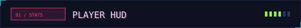

I'm a **Software Development Engineer at Wasp3D** (Noida, India), on the rendering side of a real-time graphics engine: planar reflections, water simulation, HLSL shaders and GPU resource management in **C++ / DirectX 12**. Before that I shipped full-stack **MERN** products with JWT / OAuth auth and **Gemini** integrations. Finishing a B.Tech in Computer Science (AI & ML) at G.L. Bajaj, class of 2026. Both halves come down to the same thing: make it correct, then make it fast.


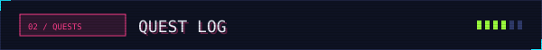

 &nbsp;<code>Apr 2026 — present</code> &nbsp;★★★★★

**Software Development Engineer** · Wasp3D, Noida (onsite)

- Cut the planar-reflection pipeline from **2 render targets to 1** through render-target packing: **~50% less GPU bandwidth** at the same visual quality.
- Built real-time water: ripple simulation, flow-map animation, distortion and planar reflections (+30% stability and fidelity).
- Wrote and debugged HLSL vertex / pixel shaders across lighting, materials and texture sampling (−40% shader defects); optimised DirectX 9/12 render targets, textures and GPU resource management (+20% performance).

  

 

 &nbsp;<code>Mar — May 2025</code> &nbsp;★★★☆☆

**Software Development Engineer Intern** · Bluestocks Fintech, remote

- Responsive services page in React + Tailwind with a modular component architecture (**20% faster page loads**); CRUD REST APIs on Express + MongoDB.
- API testing in Postman with proper error handling and edge-case validation; Agile sprints with bi-weekly stakeholder demos.

 

 

 &nbsp;<code>CGPA 8.01 / 10</code> &nbsp;★★★★☆

**B.Tech, Computer Science — AI & Machine Learning** · G.L. Bajaj Institute of Technology and Management, Greater Noida

- Tutorial zone: DSA, OOP, DBMS, operating systems, networks, system design. Solving problems most days since.

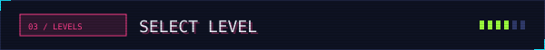

<table>
  <tr>
    <td width="50%" valign="top">
      
        ★★★★★
      <h3>AshGuard — Women Safety &amp; Travel Assistant</h3>
      
1-tap SOS (fake call, live recording, guardian alert, siren), live location, a <b>K-Means safe-route finder</b> (93% route accuracy) and a Gemini chatbot. Top 3 at Adobe Emerge 2025.

      
<code>React</code> <code>Python</code> <code>Express</code> <code>MongoDB Atlas</code> <code>Gemini</code> <code>K-Means</code>

       
    </td>
    <td width="50%" valign="top">
      
        ★★★★☆
      <h3>Lost &amp; Found Community Platform</h3>
      
Post lost or found items with photos and location; <b>JWT + Google OAuth 2.0</b>, real-time filtering and a matching algorithm that suggests likely pairs. Query tuning made search <b>40% faster</b>.

      
<code>React</code> <code>Node</code> <code>Express</code> <code>MongoDB</code> <code>OAuth 2.0</code>

       
    </td>
  </tr>
  <tr>
    <td width="50%" valign="top">
      
        ★★★★★
      <h3>Real-time Water &amp; Planar Reflections</h3>
      
Ripple simulation, flow-map animation, distortion and planar reflections shipped inside a production engine. Two reflection render targets packed into one: <b>~50% less GPU bandwidth</b>. The portfolio has a live canvas sketch of the same idea.

      
<code>C++</code> <code>DirectX 12</code> <code>HLSL</code> <code>Render targets</code>

       
    </td>
    <td width="50%" valign="top">
      
        ★★★★☆
      <h3>DirectX 12 Procedural Mesh Renderer</h3>
      
Procedural textured <b>cube and cone</b> through a hand-rolled DX12 pipeline: vertex/index buffers, root signature, constant buffer, resource barriers, swap chain, GPU fence. Lambert lighting in HLSL.

      
<code>C++</code> <code>DirectX 12</code> <code>Win32</code> <code>HLSL</code>

       
    </td>
  </tr>
  <tr>
    <td width="50%" valign="top">
      
        ★★★★☆
      <h3>Gemini Function-Calling Agents</h3>
      
A tool-using assistant (math, live crypto prices, weather) and a <b>terminal coding agent</b> that plans → executes → validates shell commands to scaffold a whole frontend project.

      
<code>Node.js</code> <code>@google/genai</code> <code>Gemini 2.5 Flash</code> <code>function calling</code>

       
    </td>
    <td width="50%" valign="top">
      
        ★★★☆☆
      <h3>AI Trip Planner</h3>
      
Tell it where, how long and your budget; Gemini writes a <b>day-by-day itinerary</b> with hotels, meals and safety notes, saved to your account.

      
<code>React</code> <code>Vite</code> <code>Firebase</code> <code>Gemini</code>

       
    </td>
  </tr>
</table>

Bonus stages: <a href="https://github.com/Amirchoudhary09/port">this portfolio</a> (single-file arcade site, vanilla JS + canvas) · <a href="https://github.com/Amirchoudhary09/house_predict">House Price Prediction</a> (scikit-learn behind Flask + React) · <a href="https://github.com/Amirchoudhary09/Prayer_Time">Prayer Times PWA</a> · <a href="https://github.com/Amirchoudhary09/human-machine">Insurance claim decision system</a>

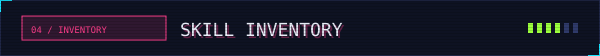

<table>
  <tr>
    <td width="50%" valign="top">
       
      
      
      
      
      
      
    </td>
    <td width="50%" valign="top">
       
      
      
      
      
      
      
    </td>
  </tr>
  <tr>
    <td valign="top">
       
      
      
      
      
      
      
    </td>
    <td valign="top">
       
      
      
      
      
      
      
      
      
    </td>
  </tr>
  <tr>
    <td valign="top">
       
      
      
      
      
      
    </td>
    <td valign="top">
       
      
      
      
    </td>
  </tr>
  <tr>
    <td valign="top">
       
      
      
      
      
      
      
    </td>
    <td valign="top">
       
      
      
      
      
      
      
      
    </td>
  </tr>
</table>

  

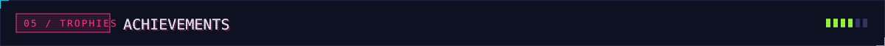

<a href="https://leetcode.com/u/AMIR09/">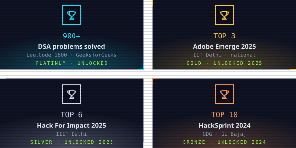</a>

Hidden achievement: AshGuard selected for the Bharat Shiksha 3-day expo.

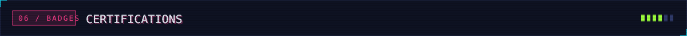

<table>
  <tr>
    <td></td>
    <td><b>Google for Developers — Virtual Internship</b> Google</td>
    <td align="right"></td>
  </tr>
  <tr>
    <td></td>
    <td><b>CCNA / Python Certification</b> Cisco</td>
    <td align="right"></td>
  </tr>
  <tr>
    <td></td>
    <td><b>Web Development Competition</b> See Caller · inter-college competition</td>
    <td align="right"></td>
  </tr>
  <tr>
    <td></td>
    <td><b>Coding Competition</b> HackSprint, GDG GL Bajaj</td>
    <td align="right"></td>
  </tr>
</table>

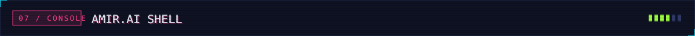

<a href="https://port-omega-rust.vercel.app/#console">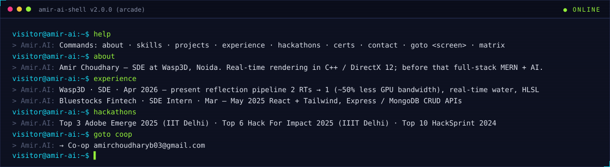</a>

Replay only. The real shell (tab-complete, history, <code>matrix</code>, Konami code) runs on <a href="https://port-omega-rust.vercel.app/#console">the portfolio</a>.

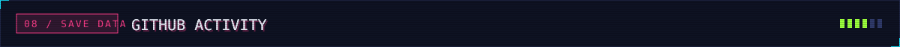

<!-- github-profile-summary-cards instead of github-readme-stats: the public readme-stats instance is rate-limited most of the day -->

  
  

  

  <picture>
    <source media="(prefers-color-scheme: dark)" srcset="https://raw.githubusercontent.com/Amirchoudhary09/Amirchoudhary09/output/github-snake-dark.svg">
    
  </picture>

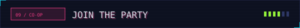

Have a project idea, an SDE opportunity, or want to talk low-level graphics and DirectX / WebGL pipelines? The inbox is open. Spawn point: Greater Noida, India.

  
  
  
  
  

  

<!--
  assets/*.svg (hero, hud-* headers, attributes, trophies, console, footer) are generated by
  tools/gen.js: `node tools/gen.js assets`. Fonts (Press Start 2P, Share Tech Mono, Chakra Petch)
  are embedded as base64 so they render inside GitHub's image sandbox. Panels other than the hero
  are authored 600px wide so they stay legible on phones. Edit the script, not the SVGs.
-->
